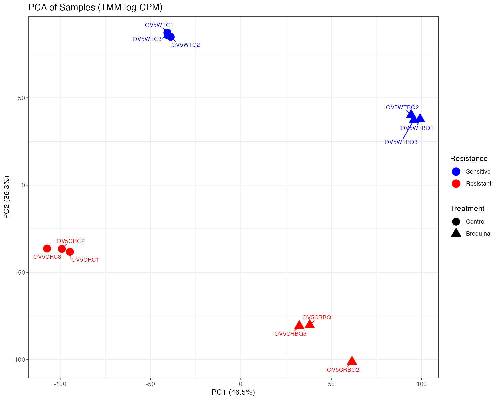
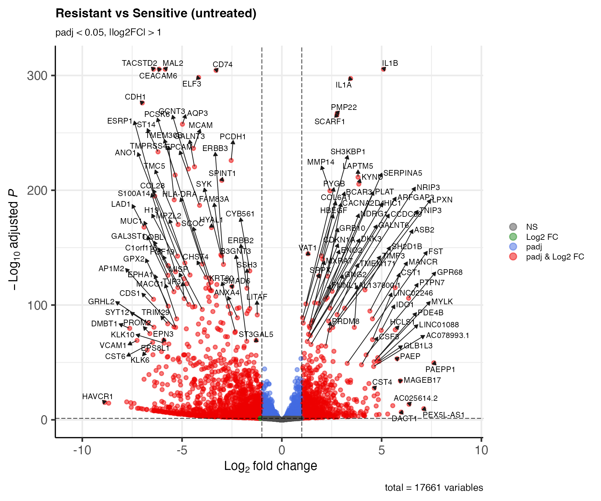

# RNA-seq Analysis of Cisplatin Resistance in Ovarian Cancer Cells

Differential expression analysis of cisplatin-sensitive and cisplatin-resistant OVCAR5 ovarian cancer cells, with and without the DHODH inhibitor brequinar, and a targeted test of whether pyrimidine metabolism genes differ with resistance.

## Questions

1. Which transcriptional programs differ between cisplatin-resistant and cisplatin-sensitive cells?
2. Is de novo pyrimidine synthesis (the pathway brequinar blocks at DHODH) transcriptionally altered in resistant cells?
3. Does brequinar affect resistant and sensitive cells differently?

## Dataset

- **Source:** GEO [GSE283381](https://www.ncbi.nlm.nih.gov/geo/query/acc.cgi?acc=GSE283381) (public gene-level count files)
- **Cells:** OVCAR5; OV5WT = cisplatin-sensitive, OV5CR = cisplatin-resistant
- **Design:** 2 × 2, 3 replicates per group (12 samples): Sensitive / Resistant × Control / Brequinar

## Pipeline

Seven R scripts, run in order by Snakemake:

| Step | Script | What it does |
|---|---|---|
| 1 | `01_load_and_qc.R` | Builds the count matrix, filters low-count genes (≥10 counts in ≥3 samples), TMM log-CPM for QC: PCA, sample distance and correlation heatmaps |
| 2 | `02_deseq_analysis.R` | DESeq2: three pairwise contrasts (`~ Condition`) and a Resistance × Treatment interaction model; fold changes shrunk with `ashr` |
| 3 | `03_visualization.R` | Volcano and MA plots; top-50 gene heatmaps on VST-transformed counts |
| 4 | `04_annotation.R` | Adds Ensembl/Entrez IDs, gene names and biotypes (`org.Hs.eg.db`, offline) |
| 5 | `05_pathway_analysis.R` | GO and KEGG over-representation (clusterProfiler) for up- and down-regulated genes separately, with all tested genes as background |
| 6 | `06_pyrimidine_analysis.R` | Curated 35-gene pyrimidine panel (de novo, salvage, transport, catabolism); per-gene results and rank-based branch tests |
| 7 | `07_biomarker_analysis.R` | Candidate resistance markers, final summary, `sessionInfo()` |

## Key results

| Comparison | Genes with padj < 0.05 | of which \|log2FC\| > 1 |
|---|---|---|
| Resistant vs Sensitive (untreated) | 5,557 (2,640 up, 2,917 down) | 726 up, 1,421 down |
| Brequinar vs Control, Resistant cells | 10,644 | 2,877 up, 1,973 down |
| Brequinar vs Control, Sensitive cells | 10,300 | 2,679 up, 1,906 down |
| Interaction (Resistance × Treatment) | 1,282 | 85 up, 37 down |

17,661 genes were tested after filtering. Fold-change cutoffs use shrunken estimates.



Samples separate by resistance status and by treatment (PC1 46.5%, PC2 36.3%), and replicates cluster tightly.

### 1. Resistant vs sensitive cells



- **Lower in resistant cells:** epithelial genes (CDH1, EPCAM, ELF3, ST14, TACSTD2, CEACAM6) and MHC class II antigen presentation genes (CD74, HLA-DRA). Enriched terms include humoral immune response, MHC class II protein complex assembly, epidermis development, cell adhesion molecules and cornified envelope formation.
- **Higher in resistant cells:** IL1A, IL1B, MMP14 and extracellular-matrix genes. Enriched terms include extracellular matrix organization, chemotaxis, and complement and coagulation cascades.
- Taken together, resistant cells show reduced epithelial gene programs and a shift in immune-related and extracellular-matrix genes. This is an expression pattern in one cell-line pair; it does not establish that these changes cause resistance.

### 2. Pyrimidine metabolism

- **De novo synthesis genes were not differentially expressed** between untreated resistant and sensitive cells: 13 of 14 genes unchanged, DHODH log2FC −0.16 (padj 0.35), rank-based set test p = 0.25. The starting hypothesis, increased de novo synthesis in resistant cells, is not supported at the transcript level.
- Several salvage genes were modestly higher in resistant cells (UPP1, TK2, DCK; log2FC 0.35–0.86), but the salvage set as a whole did not reach significance (p = 0.055). The nucleoside transporter SLC29A2 (ENT2) was lower (log2FC −1.09, padj ≈ 1e-20).
- NT5E (CD73) was higher in resistant cells (log2FC 0.75). CD73 mainly produces extracellular adenosine, so it is reported separately rather than as evidence for pyrimidine salvage.

### 3. Brequinar response

- Brequinar changed about 60% of tested genes in both cell lines (10,644 resistant, 10,300 sensitive), so the size of the response is similar.
- In both lines, immune and cytokine signaling genes increased, and small-GTPase, adhesion and axon-guidance genes decreased. DPYD, the first enzyme of pyrimidine breakdown, fell about 4-fold in both lines (log2FC ≈ −2.1).
- Oxidative phosphorylation genes were enriched among brequinar-induced genes in resistant cells only (KEGG, 32 genes). DHODH is linked to the mitochondrial electron transport chain, so this is plausible, but it is an observation, not a tested mechanism.
- **Interaction:** 1,282 genes responded to brequinar differently in resistant and sensitive cells (top: AQP3, GAL3ST1, ELF3). Brequinar lowered de novo pyrimidine genes in sensitive cells (set test p = 0.004) but not in resistant cells (interaction p = 0.007). For RRM2 and TYMS this pattern is consistent across replicates. For DUT and NME1 it is driven largely by one resistant + brequinar replicate (OV5CRBQ2), which clusters apart from the other two. RRM2, TYMS and TK1 are also cell-cycle genes, so this may reflect a difference in proliferation rather than pyrimidine-specific regulation.

### 4. Candidate resistance markers

363 genes passed padj < 0.01, |log2FC| > 2 and baseMean > 100 in the untreated comparison (85 higher, 278 lower in resistant cells), dominated by loss of epithelial genes. Their differences were consistent across replicates and persisted under brequinar. They are candidates from a single cell-line pair and would need validation in other models.

## Methods notes

- **Filtering:** genes with ≥10 counts in at least 3 samples (the smallest group size).
- **Differential expression:** DESeq2, Benjamini–Hochberg padj < 0.05. Pairwise contrasts come from a 4-level `Condition` model; the interaction from `~ Resistance + Treatment + Resistance:Treatment` with Sensitive and Control as reference levels. Fold changes are shrunk with `lfcShrink(type = "ashr")`; p-values are unaffected.
- **Enrichment:** clusterProfiler over-representation, run separately on up- and down-regulated genes (padj < 0.05, |log2FC| > 1), with the 17,661 tested genes as the background universe. GO uses `org.Hs.eg.db`; KEGG is queried online.
- **Heatmaps:** variance-stabilizing transform (VST), row z-scores capped at ±3.
- **Pyrimidine panel:** 35 curated genes matched by exact symbol (31 passed filtering). Branch-level tests use `limma::geneSetTest` on signed −log10 p-values. These tests ignore correlation between genes, so they are exploratory.
- **Package versions:** `results/sessionInfo.txt`.

## Repository structure

```
├── Snakefile
├── scripts/            # setup.R + steps 01-07
├── data/               # GEO count files (not tracked; see below)
└── results/
    ├── QC/             # PCA, distance and correlation heatmaps
    ├── DESeq2/         # results tables for all four comparisons
    ├── visualization/  # volcano, MA and heatmap PDFs
    ├── enrichment/     # GO/KEGG tables and dotplots; pyrimidine panel
    ├── biomarkers/     # candidate markers and pipeline summary
    └── figures/        # PNGs used in this README
```

## How to reproduce

**1. Download the count files.** Download the `.count.out.txt` files for GSM8661174–GSM8661185 from [GSE283381](https://www.ncbi.nlm.nih.gov/geo/query/acc.cgi?acc=GSE283381) and place them in `data/`.

**2. Install R packages** (developed with R 4.5.1; exact versions in `results/sessionInfo.txt`):

```r
install.packages(c("BiocManager", "ggplot2", "pheatmap", "ggrepel", "dplyr", "tibble", "tidyr", "ashr"))
BiocManager::install(c("DESeq2", "edgeR", "limma", "EnhancedVolcano",
                       "clusterProfiler", "org.Hs.eg.db"))
```

**3. Run the pipeline** from the repository root:

```bash
snakemake --cores 4
```

Or run the scripts in order with `Rscript scripts/01_load_and_qc.R`, then 02 through 07. KEGG enrichment needs an internet connection; if KEGG is unreachable, GO results are still produced.

## Limitations

- One cell-line pair (OVCAR5 sensitive vs resistant); findings need validation in other models.
- Three replicates per group; one resistant + brequinar replicate (OV5CRBQ2) differs from the other two for some genes.
- Transcript levels only. Pyrimidine pathway activity was not measured directly (no metabolomics or flux data).
- Over-representation and gene-set tests depend on cutoffs and do not account for correlation between genes.

## Reference

Data: GEO accession GSE283381. Analysis tools: DESeq2 (Love et al., 2014), ashr (Stephens, 2017), clusterProfiler (Wu et al., 2021), edgeR, limma, EnhancedVolcano, Snakemake.